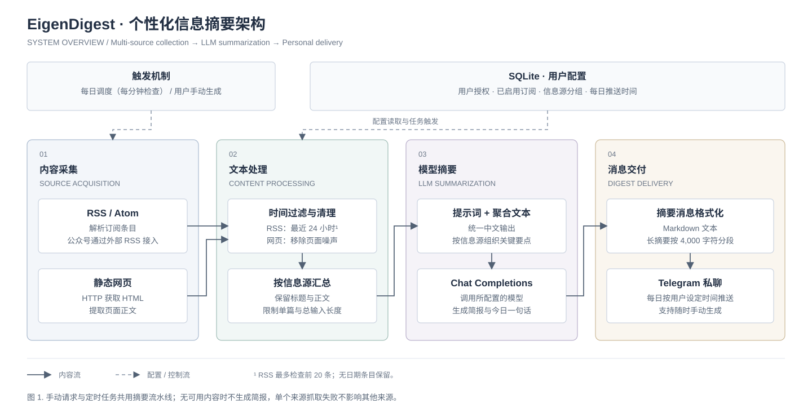

<div align="center">

# 📰 EigenDigest Bot

### 把你关注的信息，变成每天的一份简报。

聚合 RSS 与网页 · AI 中文摘要 · Telegram 定时推送

[](https://www.python.org/)
[](https://core.telegram.org/bots)
[](#快速开始)
[](LICENSE)

[功能亮点](#功能亮点) · [工作流程](#工作流程) · [快速开始](#快速开始) · [使用指南](#使用指南) · [常见问题](#常见问题)

</div>

---

**EigenDigest** 是一个可自托管的 Telegram 信息摘要机器人。订阅你关心的博客、新闻和网页，选择每天接收简报的时间，它会自动抓取内容、调用大语言模型整理重点，再发送到你的 Telegram 私聊。

适合希望集中阅读科技、开源、财经等资讯的个人，也适合通过邀请制与朋友共享一套部署。每位用户拥有独立的信息源、分组和推送时间。

## 功能亮点

| 能力 | 你可以做什么 |
| --- | --- |
| 📡 多源聚合 | 订阅 RSS / Atom、提取网页正文，接入已转换为 RSS 的微信公众号内容 |
| 🧠 中文简报 | 按信息源整理要点，将英文内容归纳为中文，并生成「今日一句话」 |
| ⏰ 个性化推送 | 为每位用户设置每日推送时间，或使用 `/digest` 随时生成 |
| 👥 多用户与邀请制 | 管理员生成一次性邀请码，用户独立管理自己的订阅 |
| 🗂️ 分组与预设 | 按主题批量导入、启停或删除信息源，内置五类订阅预设 |
| 💬 按钮式交互 | 通过 Telegram 菜单完成添加订阅、设置时间和用户管理 |
| 🔌 灵活选择模型 | 配置 API 地址和模型名称，使用兼容 OpenAI Chat Completions 的服务 |
| 🐳 轻量自托管 | Docker Compose 启动，SQLite 保存用户、订阅与设置，无需额外数据库服务 |

## 工作流程

```mermaid
flowchart LR
    A["每分钟检查用户推送时间"] --> C["读取该用户已启用的信息源"]
    B["用户发送 /digest 或点击立即生成"] --> C
    DB[("SQLite · 用户 / 订阅 / 设置")] -.-> A
    DB -.-> C

    C --> D{"信息源类型"}
    D -->|RSS / Atom / 微信 RSS| E["RSSFetcher · 解析订阅条目"]
    D -->|网页| F["WebFetcher · 提取页面正文"]
    E --> G["筛选最近 24 小时内容<br/>无日期条目保留，最多检查前 20 条"]
    F --> H["清理页面噪声并截取正文"]
    G --> I["按信息源汇总抓取结果"]
    H --> I

    I --> J{"是否取得内容？"}
    J -->|否| K["定时任务跳过推送<br/>手动请求返回提示"]
    J -->|是| L["LLM · 生成中文要点与今日一句话"]
    L --> M["Telegram 私聊推送<br/>长摘要分段发送"]

    classDef trigger fill:#eff6ff,stroke:#3b82f6,color:#1e3a8a
    classDef fetch fill:#f0fdfa,stroke:#14b8a6,color:#134e4a
    classDef ai fill:#f5f3ff,stroke:#8b5cf6,color:#4c1d95
    classDef output fill:#f0fdf4,stroke:#22c55e,color:#14532d
    class A,B trigger
    class E,F,G,H,I fetch
    class L ai
    class M output
```



<details>
<summary>查看 Mermaid 流程图</summary>



</details>

同一用户的信息源并发抓取，单个来源失败时继续处理其他来源；定时任务最多同时处理 5 位用户的摘要。手动生成与定时推送共用摘要流水线。

### 简报长什么样？

以下为格式示意，非实际新闻或运行截图；具体措辞由所配置的模型生成。

```text
📰 每日信息摘要
━━━━━━━━━━━━━━━

📌 科技博客
• 新发布的模型聚焦推理能力与开发者工具，值得关注其适用场景。
• 一篇技术文章梳理了模型部署中的成本与延迟取舍。

📌 开源社区
• 本期项目更新包含性能优化和文档改进。
• 社区分享了一个自动整理订阅信息的实践案例。

━━━━━━━━━━━━━━━
💡 今日一句话：从技术更新中挑出与你的工作真正相关的变化。
```

## 快速开始

### 1. 获取代码与配置

准备好 Docker Compose，或 Python 3.11 环境，以及 Telegram Bot Token 和模型 API Key。运行环境需要能访问 Telegram、模型 API 和订阅的网站。

```bash
git clone https://github.com/jielosc/EigenDigest_bot.git
cd EigenDigest_bot
cp .env.example .env
```

编辑 `.env`，填入自己的配置：

```dotenv
TELEGRAM_BOT_TOKEN=your_bot_token_here
ADMIN_USER_ID=123456789
OPENAI_API_KEY=your_api_key_here
OPENAI_BASE_URL=https://api.openai.com/v1
LLM_MODEL=gpt-4o-mini
```

| 变量 | 说明 | 默认值 |
| --- | --- | --- |
| `TELEGRAM_BOT_TOKEN` | 必填，通过 [@BotFather](https://t.me/BotFather) 创建机器人后获取 | 无 |
| `ADMIN_USER_ID` | 必填，管理员的 Telegram 数字 ID，可通过 [@userinfobot](https://t.me/userinfobot) 查询 | `0`，启动时会校验 |
| `OPENAI_API_KEY` | 必填，模型服务的 API Key | 无 |
| `OPENAI_BASE_URL` | 模型服务 API 基础地址，需兼容 Chat Completions | `https://api.openai.com/v1` |
| `LLM_MODEL` | 所用服务支持的模型名称 | `gpt-4o-mini` |
| `DB_PATH` | SQLite 文件路径 | 本地为 `eigendigest.db`；Compose 中为 `/data/eigendigest.db` |

推送时间默认 **08:00**，所有用户统一使用 **Asia/Shanghai（UTC+8，北京时间）**。如需修改全局时区，编辑 [config.py](config.py) 中的 `TIMEZONE`；当前不通过环境变量配置时区。

### 2. 启动机器人

**Docker Compose（推荐）**

```bash
# 构建并在后台运行
docker compose up -d --build

# 查看运行日志
docker compose logs -f bot
```

数据库和日志保存在命名卷 `bot-data` 中，重建容器会保留数据。日常维护可使用：

```bash
# 重启
docker compose restart bot

# 停止并移除容器，保留数据卷
docker compose down
```

> `docker compose down -v` 会删除数据卷及其中的数据。更新 `.env` 后，使用 `docker compose up -d` 重建受影响的容器以应用配置。

<details>
<summary><strong>本地运行（Python 3.11）</strong></summary>

```bash
python3.11 -m venv .venv
source .venv/bin/activate
pip install -r requirements.txt
python main.py
```

Windows 激活虚拟环境时使用 `.venv\Scripts\activate`。本地默认在工作目录下生成 `eigendigest.db` 和 `eigendigest.log`。

</details>

机器人通过 long polling 接收消息，无需配置 Webhook 或开放入站端口。

### 3. 收到第一份简报

在 Telegram 中打开你创建的机器人私聊：

1. 发送 `/start`，配置的管理员账号会自动获得管理权限。
2. 发送 `/import 科技与AI` 导入一组订阅，也可以通过菜单添加自己的来源。
3. 发送 `/digest`，立即生成一份摘要。
4. 发送 `/settime 08:30`，设置以后每天的接收时间。

## 使用指南

### 添加自己的信息源

直接发送 `/add` 可进入按钮引导，也可以用一条命令完成添加：

```text
/add <类型> <名称> <URL> [分组]
```

```text
/add rss HackerNews https://news.ycombinator.com/rss 科技
/add web Python首页 https://www.python.org/ 开发
/settime 08:30
/digest
```

分组省略时使用「默认」。名称含空格时可以用双引号包裹。

| 类型 | 输入什么 URL | 处理方式 |
| --- | --- | --- |
| `rss` | RSS / Atom 订阅地址 | 解析条目；有日期时过滤掉超过 24 小时的内容 |
| `web` | 可直接访问的网页地址 | 提取当前页面正文，每次抓取作为一篇内容 |
| `wechat` | 已由外部服务转换好的公众号 RSS 地址 | 复用 RSS 抓取器；不直接抓取公众号历史文章 |

### 邀请朋友使用

管理员发送 `/invite` 生成一次性邀请码。朋友先打开机器人，点击「🔑 输入邀请码」后发送邀请码，或使用 `/join <邀请码>` 加入。

新加入的用户会自动导入「科技与AI」核心预设，随后可以自行增删订阅、调整分组和设置推送时间。管理员也可以使用 `/adduser <user_id> [用户名]` 直接授权；被授权的用户仍需先在 Telegram 中与机器人建立私聊，才能接收消息。

### 内置预设

| 分组 | 部分内置来源 |
| --- | --- |
| 科技与AI | OpenAI 博客、Hugging Face 博客、Hacker News、少数派 |
| 开发与开源 | GitHub Blog、Stack Overflow Blog、Python Blog、Rust Blog |
| 商业财经 | 华尔街日报、Bloomberg Markets、CNBC、Financial Times |
| 设计产品 | Dribbble Stories、Design Milk、UX Collective、CSS-Tricks |
| 网络安全 | The Hacker News、Krebs on Security、BleepingComputer |

使用 `/presets` 查看预设，使用 `/import <分组名>` 批量导入。完整列表见 [db/presets.py](db/presets.py)；第三方订阅地址的可用性取决于来源网站。

### 命令速查

<details>
<summary><strong>用户命令</strong></summary>

| 命令 | 说明 |
| --- | --- |
| `/start` | 打开欢迎页或主菜单 |
| `/join <邀请码>` | 使用一次性邀请码加入 |
| `/help` | 查看帮助 |
| `/add` | 按引导添加信息源，也支持带参数快速添加 |
| `/remove <名称>` | 删除信息源 |
| `/list` | 按分组查看信息源 |
| `/toggle <名称>` | 启用或禁用信息源 |
| `/presets` | 查看预设分组 |
| `/import <分组名>` | 导入预设分组 |
| `/groups` | 查看分组概览 |
| `/togglegroup <分组>` | 启用或禁用整组 |
| `/delgroup <分组>` | 删除整组信息源 |
| `/settime <HH:MM>` | 设置每日推送时间，也支持菜单快捷按钮 |
| `/digest` | 立即生成摘要 |

</details>

<details>
<summary><strong>管理员命令</strong></summary>

| 命令 | 说明 |
| --- | --- |
| `/admin` | 打开管理员面板 |
| `/invite` | 生成一次性邀请码 |
| `/adduser <user_id> [用户名]` | 直接添加并授权用户 |
| `/users` | 查看用户及订阅数量 |
| `/kick <user_id>` | 移除用户及其订阅、设置 |

</details>

## 常见问题

**为什么没有收到摘要？**

先确认已在 Telegram 中私聊机器人，并有启用的信息源。RSS 最近 24 小时没有新内容、来源抓取失败、模型调用失败，都可能导致没有简报。可发送 `/digest` 排查，并查看日志中的抓取和模型调用记录。

**网页和公众号都能直接抓取吗？**

网页提取基于返回的 HTML，不执行 JavaScript；需要登录、动态渲染或有访问限制的页面可能无法提取。`wechat` 类型需要外部提供的 RSS 地址。

**重复生成会去重吗？**

目前没有已读记录或跨次去重。同一天多次生成可能包含相同内容，网页来源也会重复提取当前页面。

**订阅越多，摘要就越完整吗？**

当前会限制单篇内容长度，并将汇总后的模型输入截断至约 12,000 字符。来源过多时，排在后面的内容可能无法进入摘要；建议只启用关心的来源。每次生成都会调用你配置的模型服务，费用取决于服务商与用量。

## 项目结构

```text
EigenDigest_bot/
├── main.py                 # 启动、Telegram 菜单与处理器注册
├── config.py               # 环境变量与全局默认配置
├── bot/
│   ├── handlers.py         # 命令、按钮交互与权限管理
│   └── scheduler.py        # 每分钟调度检查与用户摘要流水线
├── fetchers/
│   ├── base.py             # Article 数据结构与抓取器接口
│   ├── rss_fetcher.py      # RSS / Atom 解析与时间过滤
│   └── web_fetcher.py      # HTML 正文提取
├── llm/
│   └── summarizer.py       # 摘要提示词与模型调用
├── db/
│   ├── models.py           # SQLite 用户、邀请码、订阅与设置
│   └── presets.py          # 主题预设与新用户默认订阅
├── .env.example            # 配置模板
├── requirements.txt        # Python 依赖
├── Dockerfile
└── docker-compose.yml      # 容器部署与数据持久化
```

想调整简报风格，可以修改 [llm/summarizer.py](llm/summarizer.py) 中的 `SYSTEM_PROMPT`；想增加默认订阅，可以修改 [db/presets.py](db/presets.py)。

## 参与贡献

欢迎通过 [Issues](https://github.com/jielosc/EigenDigest_bot/issues) 反馈问题或提出想法，也欢迎提交 Pull Request。报告问题时，请附上复现步骤、部署方式和已去除 Token / API Key 的相关日志。

## 许可证

本项目基于 [MIT License](LICENSE) 开源。
